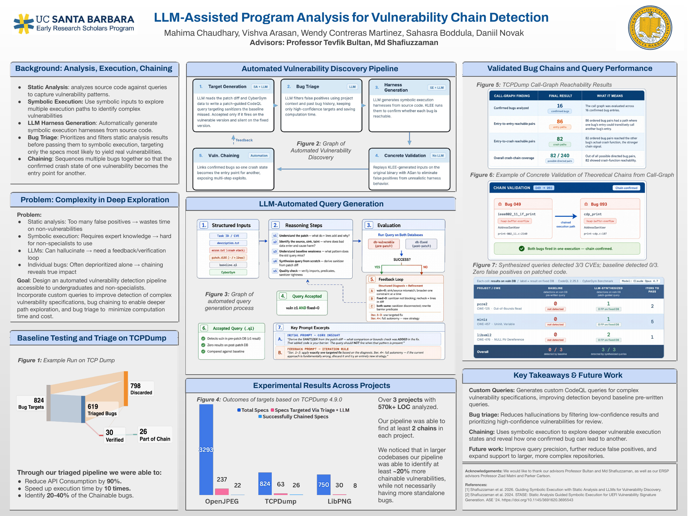
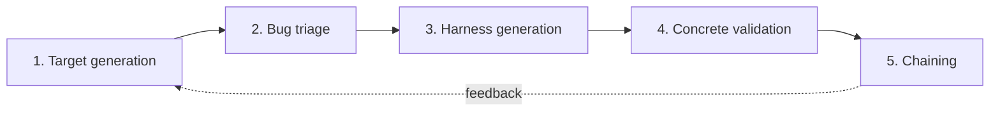

# ERSP Chain Detection Project

**LLM-Assisted Program Analysis for Vulnerability Chain Detection**
UC Santa Barbara · Early Research Scholars Program (ERSP)

We built a pipeline that finds security bugs in C/C++ programs and links them into **bug chains**, where the crash from one bug leads into another. It combines static analysis (CodeQL), large language models, and symbolic execution (KLEE), and it is designed for undergraduates and non-specialists to use.

[](docs/ERSP_poster.pdf)

📄 [Poster (PDF)](docs/ERSP_poster.pdf) · 🖼️ [ERSP slides (Google Drive)](https://drive.google.com/file/d/1jd5WhyGmWukvNxAWZWZkm5wxxREwqBcW/view)

**Team:** Mahima Chaudhary, Vishva Arasan, Wendy Contreras Martinez, Sahasra Boddula, Daniil Novak
**Advisors:** Professor Tevfik Bultan, Md Shafiuzzaman

## Contents

1. [Highlights](#highlights)
2. [How the pipeline works](#how-the-pipeline-works)
3. [What's in this repo](#whats-in-this-repo)
4. [Quick start](#quick-start)
5. [Detailed results](#detailed-results)
6. [Acknowledgements and references](#acknowledgements-and-references)

## Highlights

- **90% fewer LLM API calls and 10× faster runs**, because an LLM triages bugs before the expensive steps.
- **At least 2 confirmed bug chains in each of 3 projects** (OpenJPEG, TCPDump, LibPNG; over 570k lines of code). The pipeline found 20–40% of the chainable bugs.
- **3 of 3 CVEs caught by LLM-written CodeQL queries.** The standard CodeQL queries caught 0 of 3, and the new queries had zero false positives.

## How the pipeline works



| Step | What happens | Tools |
|---|---|---|
| **1. Target generation** | An LLM reads a security patch and writes a CodeQL query for that bug. A query is kept only if it flags the vulnerable code and stays quiet on the fixed code. | CodeQL, LLM |
| **2. Bug triage** | An LLM filters out likely false positives so only promising targets move on. | LLM |
| **3. Harness generation** | An LLM writes a KLEE harness, and KLEE checks whether the bug can be reached. | KLEE, LLM |
| **4. Concrete validation** | KLEE's inputs are replayed on the real program with AddressSanitizer to confirm the crash is real. | AddressSanitizer |
| **5. Chaining** | Confirmed bugs are linked so that one bug's crash state becomes the starting point for the next. | Automated |

> **New to these tools?**
> - **CodeQL** searches source code for bug patterns, like a database query.
> - **KLEE** runs a program on *symbolic* inputs, which lets it explore many execution paths at once.
> - A **harness** is a small `main()` that sets up symbolic inputs and calls the code under test.
> - **AddressSanitizer (ASan)** is a compiler option that makes a program crash loudly on memory errors.

## What's in this repo

```text
.
├── docs/                         Research poster (PDF and PNG)
├── guides/                       Onboarding guides and assignments from our advisor
│   ├── klee-assert-templates.md      How to write klee_assert checks for each CWE
│   ├── codeql-custom-query-tutorial.md
│   ├── static-analysis-week1.md
│   ├── assignment6-llm-harness-tasks.md
│   └── complex-data-structure-poc/   Example KLEE harness for a struct input
├── team/                         Each team member's work (table below)
└── SAILOR_Replication_Package/   The SAILOR pipeline this project builds on
```

### Team folders

| Folder | Who | What it is |
|---|---|---|
| [`team/daniil/`](team/daniil/) | Daniil | Custom CodeQL query for use-after-free (CWE-416), plus KLEE harnesses for CWE-123 and CWE-124 |
| [`team/daniil-llm-harness-pipeline/`](team/daniil-llm-harness-pipeline/) | Daniil | Script that asks an LLM for a KLEE harness, builds and runs it, and retries with the error output until it works |
| [`team/mahima/`](team/mahima/) | Mahima | KLEE harnesses for double free (CWE-415) and use-after-free (CWE-416) |
| [`team/sahasra/`](team/sahasra/) | Sahasra | KLEE harnesses for buffer over-read (CWE-126) and integer underflow (CWE-191) |
| [`team/sahasra-klee-assert-generation/`](team/sahasra-klee-assert-generation/) | Sahasra | Script that finds the vulnerable line and has an LLM write the `klee_assert` for it |
| [`team/vishva/`](team/vishva/) | Vishva | KLEE harnesses for stack and heap buffer overflows (CWE-121, CWE-122), plus a custom CodeQL query for unsafe `memcpy` lengths |
| [`team/vishva-mahima-klee-pipeline/`](team/vishva-mahima-klee-pipeline/) | Vishva and Mahima | One script that compiles, links, and runs a harness under KLEE |
| [`team/wendy/`](team/wendy/) | Wendy | LLM-generated KLEE harnesses for integer overflow (CWE-190) and divide-by-zero (CWE-369) |
| [`team/wendy-llm-prompt/`](team/wendy-llm-prompt/) | Wendy | Reusable LLM prompt that writes the harness and instrumented file for any C function |

Each folder has its own README with details.

[`SAILOR_Replication_Package/`](SAILOR_Replication_Package/) is the replication package for SAILOR, our advisor Md Shafiuzzaman's pipeline that combines CodeQL, LLM-written harnesses, KLEE, and ASan. It has 21 custom CodeQL rules, baseline comparisons, and configs for 10 open-source projects. See [its README](SAILOR_Replication_Package/README.md).

> **Note:** The chaining and query-generation results above come from our final poster. This repo holds the groundwork (harness generation and custom CodeQL queries) and the SAILOR pipeline we extended.

## Quick start

### 1. Install the tools

| Tool | Needed for | Install |
|---|---|---|
| KLEE and Clang | Steps 2–4 | Easiest option: `docker run --rm -it -v "$PWD":/home/klee/work klee/klee` (see the [KLEE docs](https://klee-se.org/getting-started/)) |
| Python 3.10+ | Steps 4 and 6 | [python.org](https://www.python.org/downloads/) |
| CodeQL CLI | Step 5 | [CodeQL CLI releases](https://github.com/github/codeql-cli-binaries/releases) |
| Docker and an LLM API key | Step 6 | [Docker](https://docs.docker.com/get-docker/) |

### 2. Run your first KLEE harness

This example makes a whole struct symbolic. It includes its own copy of the KLEE headers, so no extra flags are needed.

```bash
cd guides/complex-data-structure-poc
clang -emit-llvm -c -g complex_data_structure_symbolic_driver.c -o poc.bc
klee poc.bc
```

KLEE saves its results in `klee-last/`. If it finds a bug, it writes an `.err` file that describes it and a `.ktest` file with the input that triggers it. You can read the input with `ktest-tool klee-last/test000001.ktest`.

### 3. Try a team member's harness

Every harness folder uses the same two files:

- `driver_*.c` sets up symbolic inputs and includes the instrumented file.
- `instrumented_*.c` holds the vulnerable function, with a `klee_assert` placed right before the buggy line.

```bash
cd team/mahima/CWE415_Double_Free__malloc_free_char_01
clang -I <klee>/include -emit-llvm -c -g -O0 driver_CWE415_s01_bad.c -o harness.bc
klee harness.bc
```

Replace `<klee>` with your KLEE source folder. In the KLEE Docker image, that is `/home/klee/klee_src`. KLEE should report `memory error: double free`. A saved copy of the expected output is in `klee-out-0/`.

To write a harness of your own, start with [`guides/klee-assert-templates.md`](guides/klee-assert-templates.md).

### 4. Generate a harness with an LLM

```bash
cd team/daniil-llm-harness-pipeline
pip install -r requirements.txt
export DEEPSEEK_API_KEY=your-key-here
python main.py config.json 10    # 10 = the maximum number of LLM calls
```

The script loops through each CWE in `cwes/`, asks the LLM for a driver and an instrumented file, and builds and runs them with KLEE. When something fails, it sends the errors back to the LLM. See [its README](team/daniil-llm-harness-pipeline/README.md) for details.

### 5. Run a custom CodeQL query

These queries were written for the [Juliet C/C++ test suite](https://github.com/arichardson/juliet-test-suite-c). From inside a Juliet test-case folder:

```bash
codeql database create juliet-db --language=cpp --command="make"
codeql pack install <this-repo>/team/daniil/codeql-custom
codeql database analyze juliet-db <this-repo>/team/daniil/codeql-custom \
    --format=sarif-latest --output=results.sarif
```

For the full walkthrough, see [`guides/codeql-custom-query-tutorial.md`](guides/codeql-custom-query-tutorial.md).

### 6. Run the full SAILOR pipeline

```bash
cd SAILOR_Replication_Package
cp .env.example .env          # add your LLM API key to .env (it is git-ignored)
bash setup_dataset.sh         # downloads the 10 target projects
docker build -t sailor .
```

Then follow the [SAILOR README](SAILOR_Replication_Package/README.md) to run the CodeQL scan and the KLEE stage.

## Detailed results

### Bug triage and chaining across projects

| Project | Total bug specs | Picked by triage | Successfully chained |
|---|---:|---:|---:|
| OpenJPEG | 3,293 | 237 | 22 |
| TCPDump 4.9.0 | 824 | 63 | 26 |
| LibPNG | 750 | 30 | 8 |

In larger codebases, the pipeline found about 20% more chainable bugs, without necessarily finding more standalone bugs.

### Bug chains in TCPDump

| Finding | Result |
|---|---:|
| Confirmed bugs analyzed | 16 |
| Bug pairs where one bug's entry can reach the other's entry | 86 |
| Bug pairs where one bug's entry can reach the other's crash | 82 |
| Crash-chain coverage | 82 of 240 pairs |

**Example chain:** Bug 049 in `ieee802_11_if_print` (heap buffer overflow, `print-802_11.c:2140`) leads to Bug 093 in `cdp_print` (heap buffer overflow, `print-cdp.c:107`). Both bugs fired in a single run under AddressSanitizer.

### LLM-written CodeQL queries

Tested on the CyberGym benchmark with CodeQL 2.25.3 and Claude Opus 4.7.

| Project | Bug type | Standard query | LLM-written query | Attempts needed |
|---|---|:-:|:-:|:-:|
| pcre2 | CWE-125 out-of-bounds read | ❌ missed | ✅ found (0 false positives) | 2 |
| miniz | CWE-457 uninitialized variable | ❌ missed | ✅ found (0 false positives) | 5 |
| libxml2 | CWE-476 NULL pointer dereference | ❌ missed | ✅ found (0 false positives) | 1 |

### What we learned

- **Custom queries:** LLM-written CodeQL queries can catch bugs that the standard queries miss.
- **Bug triage:** Filtering out low-confidence results cuts down on LLM hallucinations and saves time and money.
- **Chaining:** Symbolic execution can follow one confirmed bug into another, which shows the real impact of bugs that look minor alone.
- **Future work:** Make queries more precise, reduce false positives further, and scale to larger codebases.

## Acknowledgements and references

We thank our advisors **Professor Tevfik Bultan** and **Md Shafiuzzaman**, and our ERSP advisors **Professor Ziad Matni** and **Parker Carlson**.

This repository started from [`shafiuzzaman-md/ersp-harness-generation`](https://github.com/shafiuzzaman-md/ersp-harness-generation).

1. Shafiuzzaman et al. 2026. *Guiding Symbolic Execution with Static Analysis and LLMs for Vulnerability Discovery.*
2. Shafiuzzaman et al. 2024. *STASE: Static Analysis Guided Symbolic Execution for UEFI Vulnerability Signature Generation.* ASE '24. https://doi.org/10.1145/3691620.3695543
