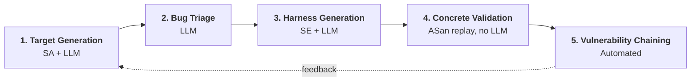

# ERSP Chain Detection Project

### LLM-Assisted Program Analysis for Vulnerability Chain Detection

**UC Santa Barbara · Early Research Scholars Program (ERSP)**

**Team:** Mahima Chaudhary · Vishva Arasan · Wendy Contreras Martinez · Sahasra Boddula · Daniil Novak
**Advisors:** Professor Tevfik Bultan · Md Shafiuzzaman
**ERSP Advisors:** Professor Ziad Matni · Parker Carlson

[](docs/ERSP_poster.pdf)

📄 **[Poster (PDF)](docs/ERSP_poster.pdf)** · 🖼️ **[ERSP slides (Google Drive)](https://drive.google.com/file/d/1jd5WhyGmWukvNxAWZWZkm5wxxREwqBcW/view)**

---

## Overview

Finding real security bugs in large C/C++ codebases is hard. Each common technique has a weak spot:

| Technique | Problem |
|---|---|
| **Static analysis** (CodeQL) | Reports too many false positives, so time goes to non-bugs |
| **Symbolic execution** (KLEE) | Needs expert-written harnesses, which is hard for non-specialists |
| **LLMs** | Can hallucinate, so they need a feedback and verification loop |
| **Single bugs** | Often deprioritized on their own; chaining shows their real impact |

**Our goal:** design an automated vulnerability detection pipeline that undergraduates and non-specialists can use. It combines **LLM-synthesized CodeQL queries** for complex vulnerability specs, **LLM bug triage** to cut compute time and cost, and **bug chaining** through symbolic execution, where the crash state of one confirmed bug becomes the entry point for another.

## Pipeline



1. **Target Generation.** An LLM reads the patch diff and CyberGym data, then writes a patch-guided CodeQL query that targets the sanitizer the baseline query missed. A query is accepted only if it **fires on the vulnerable version and stays silent on the fixed version**.
2. **Bug Triage.** An LLM filters false positives using project context and past bug history. Only high-confidence targets move on, which saves compute.
3. **Harness Generation.** An LLM generates symbolic execution harnesses from source code. KLEE runs them to confirm whether each bug is reachable.
4. **Concrete Validation.** KLEE-generated inputs are replayed on the original binary under AddressSanitizer. This removes false positives caused by unrealistic harness behavior.
5. **Vulnerability Chaining.** Confirmed bugs are linked so that one bug's crash state becomes the entry point for another, exposing multi-step exploits.

## Results

### Bug triage

Across **3 projects and over 570k lines of code**, the triaged pipeline:

- 📉 **Reduced LLM API consumption by 90%**
- ⚡ **Ran 10× faster**
- 🔗 **Identified 20–40% of the chainable bugs**

| Project | Total specs | Targeted by triage + LLM | Successfully chained |
|---|---:|---:|---:|
| OpenJPEG | 3,293 | 237 | 22 |
| TCPDump 4.9.0 | 824 | 63 | 26 |
| LibPNG | 750 | 30 | 8 |

The pipeline found **at least 2 chains in every project**. In larger codebases it found about **20% more chainable vulnerabilities**, without necessarily finding more standalone bugs.

### Bug chains in TCPDump

| Call-graph finding | Result |
|---|---:|
| Confirmed bugs analyzed | 16 |
| Entry-to-entry reachable pairs | 86 |
| Entry-to-crash reachable pairs | 82 |
| Overall crash-chain coverage | **82 / 240** directed pairs |

**Example of a confirmed chain:** Bug 049 (`ieee802_11_if_print`, heap-buffer-overflow, `print-802_11.c:2140`) → Bug 093 (`cdp_print`, heap-buffer-overflow, `print-cdp.c:107`). AddressSanitizer caught both bugs firing in a single execution.

### LLM-synthesized CodeQL queries

Tested on the CyberGym benchmark with CodeQL 2.25.3 and Claude Opus 4.7:

| Project | CWE | Baseline query | LLM-synthesized query | Iterations to pass |
|---|---|:-:|:-:|:-:|
| pcre2 | CWE-125 Out-of-Bounds Read | ❌ 0 | ✅ 1 (0 FP) | 2 |
| miniz | CWE-457 Uninitialized Variable | ❌ 0 | ✅ 1 (0 FP) | 5 |
| libxml2 | CWE-476 NULL Pointer Dereference | ❌ 0 | ✅ 2 (0 FP) | 1 |
| **Overall** | | **0 / 3** | **3 / 3** | |

The synthesized queries found **3 of 3 CVEs** (the baseline found 0 of 3) with **zero false positives** on patched code.

## Repository layout

This repository holds the team's research work. It includes the onboarding work on KLEE harness generation, LLM prompting, and custom CodeQL queries. It also includes the SAILOR replication package, which the pipeline builds on.

| Path | Author | Contents |
|---|---|---|
| [`SAILOR_Replication_Package/`](SAILOR_Replication_Package/) | Md Shafiuzzaman | **SAILOR**: static-analysis-informed, LLM-orchestrated symbolic execution (CodeQL → LLM harness synthesis → KLEE → ASan validation). Includes 21 custom CodeQL rules, baselines B1–B5, the A1 ablation, and build configs for 10 open-source projects (6.8M LOC). See its [README](SAILOR_Replication_Package/README.md). |
| [`klee_pipeline_daniil/`](klee_pipeline_daniil/) | Daniil | An automated LLM (DeepSeek) **generate → build → run KLEE → retry** loop that writes KLEE harnesses for Juliet CWE-123 and CWE-124 |
| [`daniil/`](daniil/) | Daniil | Generated harnesses and KLEE runs for CWE-123 and CWE-124, plus a custom CodeQL **use-after-free (CWE-416)** query (v1 → v2) with SARIF results |
| [`llm_harnesses_prompt_wendy/`](llm_harnesses_prompt_wendy/) | Wendy | A vulnerability-agnostic prompt that generates both the KLEE driver and the instrumented file for any C function |
| [`wendy/`](wendy/) | Wendy | LLM-generated KLEE harnesses for **CWE-190** (integer overflow) and **CWE-369** (divide-by-zero), with KLEE output screenshots |
| [`klee-assert-generation_Sahasra/`](klee-assert-generation_Sahasra/) | Sahasra | Automatic sink detection plus LLM-generated `klee_assert` insertion at the sink |
| [`sahasra/`](sahasra/) | Sahasra | KLEE harnesses for **CWE-126** (buffer over-read) and **CWE-191** (integer underflow) |
| [`mahima/`](mahima/) | Mahima | KLEE harnesses for **CWE-415** (double free) and **CWE-416** (use-after-free) |
| [`vishva/`](vishva/) | Vishva | KLEE harnesses for **CWE-121** and **CWE-122**, plus a custom CodeQL out-of-bounds `memcpy` query pack |
| [`KLEE Pipeline_Vishva,Mahima/`](KLEE%20Pipeline_Vishva,Mahima/) | Vishva & Mahima | A reusable compile → link → KLEE script for CWE-121 and CWE-129 |
| [` complex_data_structure_symbolic_driver/`](%20complex_data_structure_symbolic_driver/) | Md Shafiuzzaman | Proof of concept: making a complex `RequestFrame` struct symbolic for KLEE |
| [`StaticAnalysis/`](StaticAnalysis/) | Md Shafiuzzaman | Week 1 onboarding for static analysis and CodeQL |
| [`KLEE_ASSERT.md`](KLEE_ASSERT.md) · [`CODEQL.md`](CODEQL.md) · [`assignment6.md`](assignment6.md) | Md Shafiuzzaman | Guides and assignments: `klee_assert` templates by CWE, writing custom CodeQL queries, LLM harness tasks |
| [`docs/`](docs/) | Team | Research poster (PDF and PNG) |

> **Note:** The chaining and query-synthesis results above come from the final poster. The code in this repository covers the harness-generation and static-analysis groundwork, plus the SAILOR pipeline that the project extends.

## Getting started

### Prerequisites

- [KLEE](https://klee-se.org/) with a matching Clang/LLVM (the team used Clang/LLVM 13–14)
- [CodeQL CLI](https://github.com/github/codeql-cli-binaries)
- Python 3.10+
- An LLM API key (OpenAI, DeepSeek, or Anthropic, depending on the component)
- Docker, for the full SAILOR pipeline

### Run a single KLEE harness

Most team folders follow the same pattern: a `driver_*.c` makes the inputs symbolic and calls an `instrumented_*.c` file that holds a `klee_assert` at the vulnerable sink.

```bash
cd sahasra
clang -emit-llvm -c -g driver_CWE191_02.c -o CWE191.bc
klee CWE191.bc        # an assertion failure shows up as klee-last/*.assert.err
```

See [`KLEE_ASSERT.md`](KLEE_ASSERT.md) for `klee_assert` / `klee_assume` templates for each CWE.

### Run the LLM harness-generation loop

```bash
cd klee_pipeline_daniil
pip install -r requirements.txt
export DEEPSEEK_API_KEY=sk-...
python main.py config.json <max_api_calls>
```

### Run a custom CodeQL query

```bash
codeql database create db --language=cpp --command="make"
codeql database analyze db daniil/codeql-custom --format=sarif-latest --output=results.sarif
```

### Run the full SAILOR pipeline

Follow [`SAILOR_Replication_Package/README.md`](SAILOR_Replication_Package/README.md) and [`EXPERIMENTS.md`](SAILOR_Replication_Package/EXPERIMENTS.md). In short: `setup_dataset.sh` → `docker build -t sailor .` → `sailor_prepare.sh` (CodeQL + specs) → `sailor.sh` (LLM + KLEE + ASan validation).

## Key takeaways and future work

- **Custom queries:** LLM-generated CodeQL queries for complex vulnerability specs detect bugs that the pre-written baseline queries miss.
- **Bug triage:** Filtering out low-confidence results cuts down on hallucinations and focuses review on high-confidence vulnerabilities.
- **Chaining:** Symbolic execution can explore deeper vulnerable states and show how one confirmed bug leads to another.
- **Future work:** Improve query precision, reduce false positives further, and scale to larger and more complex repositories.

## Acknowledgements

We thank our advisors **Professor Tevfik Bultan** and **Md Shafiuzzaman**, and our ERSP advisors **Professor Ziad Matni** and **Parker Carlson**.

This repository is based on [`shafiuzzaman-md/ersp-harness-generation`](https://github.com/shafiuzzaman-md/ersp-harness-generation).

## References

1. Shafiuzzaman et al. 2026. *Guiding Symbolic Execution with Static Analysis and LLMs for Vulnerability Discovery.*
2. Shafiuzzaman et al. 2024. *STASE: Static Analysis Guided Symbolic Execution for UEFI Vulnerability Signature Generation.* ASE '24. https://doi.org/10.1145/3691620.3695543
